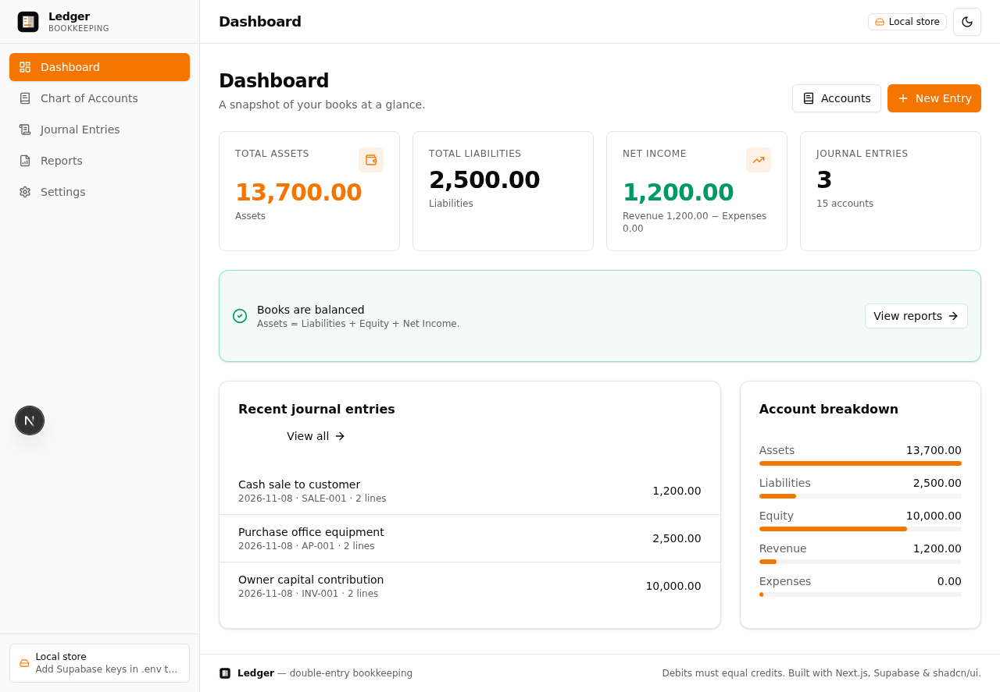

# Ledger

A minimal **double-entry bookkeeping** app that runs in the browser or as a native desktop app (Windows & Linux).

Built with Next.js 16, React 19, Tailwind CSS, shadcn/ui and Electron.



## Features

- **Chart of Accounts**: assets, liabilities, equity, revenue and expenses, each with an optional description; export to PDF or CSV and import from CSV
- **Journal Entries**: balanced debit/credit entries, plus one-click reversals; export to PDF or CSV and import from CSV
- **Reports**: Trial Balance, General Ledger, Income Statement and Balance Sheet, with PDF export
- **Dashboard**: a snapshot of your books at a glance
- **Keyboard-driven**: command palette (`Ctrl+K`) and shortcuts for new entries (`Ctrl+N`/`Alt+N`) and their lines (`Alt+L`), new accounts (`Ctrl+B`), reports (`Alt+1`–`Alt+4`) and export (`Ctrl+E` PDF, `Ctrl+Shift+E` CSV). Press `Ctrl+/` for the full list
- **Light / dark theme**
- **Storage**: a local JSON file by default, or connect Supabase or any PostgreSQL database from Settings

## Download

Prebuilt installers are published automatically on every push to `main`:

- **[Releases](../../releases)**: download `Ledger-Setup-<version>-x64.exe` (Windows) or `ledger_<version>_amd64.deb` (Linux)
- **[Packages](../../pkgs/container/ledger-desktop)**: the same installers as a container image on `ghcr.io` (see [CI/CD](#cicd))

**Windows:** run the `.exe` installer. It is not code-signed yet, so SmartScreen may warn you. Choose *More info → Run anyway*.

**Linux (Debian/Ubuntu):**

```bash
sudo dpkg -i ledger_<version>_amd64.deb
sudo apt-get install -f   # pulls in any missing system libraries
ledger
```

## Development

### Prerequisites

- [Bun](https://bun.sh) 1.3+ (the project's package manager and runtime)
- Node.js 22+ (used by Electron tooling)

### Install

```bash
bun install
```

`electron` is listed in `trustedDependencies`, so `bun install` also downloads the Electron binary (about 150 MB).

### Run the web app

```bash
bun run dev                 # http://localhost:11891
```

If port 11891 is already taken, use another port:

```bash
bunx next dev -p 12000
```

### Run the desktop app

```bash
bun run electron
```

Electron reuses a dev server already running on `http://127.0.0.1:11891`. If none is running, it starts `bun run dev` itself. To point it at a server on another port:

```bash
# bash
LEDGER_URL=http://127.0.0.1:12000 bunx electron .
# PowerShell
$env:LEDGER_URL="http://127.0.0.1:12000"; bunx electron .
```

See [electron/README.md](electron/README.md) for keyboard shortcuts and other desktop details.

## Data storage

Choose where data is stored in **Settings → Data source**. You don't need to edit any project files.

| Data source | Where data lives | Setup |
|---|---|---|
| **Local file** (default) | `ledger.json` in the data folder: `./data` in dev, the OS user-data folder for the desktop app (`%APPDATA%\Ledger` on Windows, `~/.config/Ledger` on Linux) | None |
| **Supabase** | Your Supabase project | Project URL + `service_role` key (Supabase → Project Settings → API) |
| **PostgreSQL** | Any PostgreSQL server (self-hosted, RDS, Neon, Supabase's database, …) | Host, port, database, user, password, SSL; or paste a `postgresql://…` connection string |

How it works:

- **Test connection** checks the credentials and whether the Ledger tables exist. Nothing is saved until **Save & switch** succeeds.
- **PostgreSQL:** if the tables are missing, click **Create tables**. It runs the schema for you and is safe to run again; it also upgrades older databases.
- **Supabase:** if the tables are missing, click **Copy SQL** and run it in the Supabase SQL editor (or run [`supabase/schema.sql`](supabase/schema.sql)).
- **Storage of settings:** they are saved in `config.json` next to `ledger.json`, readable only by your user account. Keys and passwords are never sent back to the browser. Leave a secret field blank to keep the stored value.
- **Switching doesn't move data.** Each data source keeps its own accounts and entries. To carry your chart of accounts over, export it as CSV and import it after switching.
- **Backwards compatible:** `NEXT_PUBLIC_SUPABASE_URL` / `SUPABASE_SERVICE_ROLE_KEY` in `.env` still work when nothing has been saved in Settings. Settings take precedence once saved.

> **Security note:** the app has no login. Anyone who can open it can change the data source, so don't expose the web version publicly without putting authentication in front of it.

`.env` and `data/` are gitignored.

## Scripts

| Command | Description |
|---|---|
| `bun run dev` | Next.js dev server on port 11891 |
| `bun run build` | Production build (standalone server in `.next/standalone`) |
| `bun run start` | Run the production build |
| `bun run lint` | ESLint |
| `bun run electron` | Launch the desktop app |
| `bun run electron:build` | Build Linux installers (AppImage + .deb) into `dist-electron/` |
| `bun run electron:build:win` | Build the Windows installer (.exe) into `dist-electron/` |

## API

The UI talks to a small REST API under `/api`:

| Route | Purpose |
|---|---|
| `GET/POST/DELETE /api/accounts`, `PUT/DELETE /api/accounts/:id` | Chart of accounts |
| `GET/POST /api/journal`, `DELETE /api/journal/:id` | Journal entries |
| `POST /api/journal/:id/reverse` | Reverse an entry |
| `POST /api/accounts/import` | Bulk-import accounts: `{ accounts: [...], mode }` where mode is `"update"` (default) or `"skip"` |
| `POST /api/journal/import` | Bulk-import journal entries: `{ entries: [...], skipDuplicates }`; lines reference accounts by `accountCode` |
| `GET /api/reports/:type` | `trial-balance`, `general-ledger`, `income-statement`, `balance-sheet`, `summary` |
| `POST /api/seed` | Load a sample chart of accounts |
| `POST /api/reset` | Clear all data |
| `GET /api/status` | Data source in use (`local`, `supabase` or `postgres`) |
| `GET/PUT /api/settings/datasource` | Read (secrets masked) or save the data source; saving tests the connection first |
| `POST /api/settings/datasource/test` | Test connection settings without saving |
| `POST /api/settings/datasource/init-schema` | Create or upgrade the Ledger tables in PostgreSQL |

## CI/CD

[`.github/workflows/desktop-build.yml`](.github/workflows/desktop-build.yml) runs on every push to `main`, on `v*` tags, or when started manually:

1. **Build**: two parallel jobs build the Next.js standalone server and package it with electron-builder:
   - `windows-latest` → `Ledger-Setup-<version>-x64.exe`
   - `ubuntu-latest` → `ledger_<version>_amd64.deb`
2. **Publish**:
   - **GitHub Release**: a push to `main` creates a pre-release `v<version>-build.<run>`; pushing a tag such as `v1.2.0` creates a full release.
   - **GitHub Packages**: pushes `ghcr.io/<owner>/ledger-desktop:<tag>` and `:latest`, an image containing only the installers under `/installers`.

To get the installers from the package:

```bash
docker create --name ledger ghcr.io/saurbase/ledger-desktop:latest x
docker cp ledger:/installers ./ledger-installers && docker rm ledger
```

New packages are **private** by default. To change that, open *Packages → ledger-desktop → Package settings*.

To cut a versioned release, bump `version` in `package.json`, then:

```bash
git tag v1.1.0
git push origin v1.1.0
```

## Project structure

```
src/
  app/                 Next.js app router (page + /api routes)
  components/ledger/   App shell and views (dashboard, accounts, journal, reports, settings)
  components/ui/       shadcn/ui components
  lib/                 Store (accounting rules), config, CSV/PDF helpers
  lib/backends/        Storage backends: local JSON file, Supabase, PostgreSQL
electron/              Electron main + preload process, app icon
supabase/schema.sql    Database schema for the Supabase / PostgreSQL backends
.github/workflows/     CI pipeline that builds and publishes the installers
```

## Known limitations

- The desktop app serves its UI on port 11891 (loopback only). If another service already answers on that port, the app connects to it instead of starting its own server.
- Installers are not code-signed.

## Importing a chart of accounts (CSV)

On **Chart of Accounts**, use **Import → Download CSV template** to get a starter file, then **Import → Import from CSV…**. The file needs these columns (the header row is required; column order doesn't matter):

| Column | Required | Notes |
|---|---|---|
| Code | yes | Unique account code, e.g. `1010` |
| Name | yes | Account name |
| Type | yes | `asset`, `liability`, `equity`, `revenue` or `expense` (also accepts `Assets`, `Income`, `Expenses`, …) |
| Subtype | no | e.g. `Current Asset` |
| Description | no | Free text |

Before anything is saved, you get a preview listing any invalid rows. If a code already exists, you choose whether to update that account or keep it as it is. A file exported with **Export → Export as CSV** can be imported back unchanged. PDF exports are for printing and sharing only; they can't be imported.

## Importing journal entries (CSV)

On **Journal Entries**, use **Import → Download CSV template** to get a starter file, or **Export → Export as CSV** to see the format with your own data. The file has **one row per line** of an entry:

| Column | Required | Notes |
|---|---|---|
| Entry | recommended | Rows with the same value form one journal entry (e.g. `1`, `1`, `2`, `2`). Without this column, rows are grouped by date + reference + description |
| Date | yes | `YYYY-MM-DD`. Only needed on the entry's first row |
| Reference | no | e.g. `INV-001` |
| Description | yes | Only needed on the entry's first row |
| Account Code | yes | Must exist in the chart of accounts; import the chart of accounts first if needed |
| Account Name | no | Ignored on import (for readability only) |
| Debit / Credit | yes | One of them per row; plain numbers such as `1200` or `1,200.00` |
| Memo | no | Line description |
| Reversal | no | Informational only |

Each entry must balance (debits = credits) and have at least two lines. The preview lists entries with problems before anything is saved; each valid entry is saved on its own. With **Skip entries that already exist** (on by default), an entry whose date, description, reference and lines match one already in the books is skipped. That makes it safe to import the same file twice, while genuinely repeated entries are still imported.

Reversal entries are imported as ordinary entries, so balances stay correct but they're no longer linked to the entry they reversed. PDF exports are for printing and sharing; they can't be imported.
